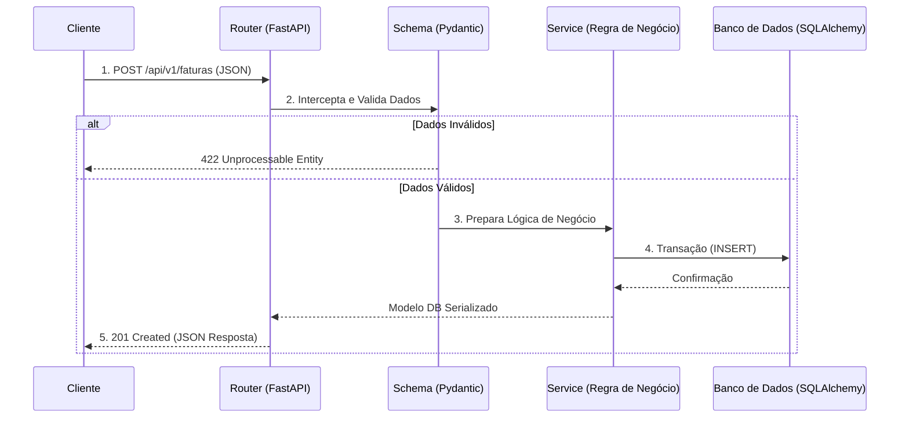

# Billing & Payment Management API

Um microsserviço de gestão de cobranças e pagamentos desenvolvido em **Python** com **FastAPI**. 

Este projeto faz parte do meu portfólio e tem como objetivo demonstrar boas práticas de engenharia de software, arquitetura escalável e integração com bancos de dados relacionais e mensageria assíncrona.

## Arquitetura do Sistema

O diagrama abaixo ilustra o ciclo de vida de uma requisição dentro da nossa API, desde a entrada do cliente até a resposta do servidor:



### Tecnologias Utilizadas
* **Framework:** FastAPI (Assíncrono, Rápido, Tipado)
* **Linguagem:** Python 3.10+
* **Validação de Dados:** Pydantic
* **ORM:** SQLAlchemy
* **Banco de Dados:** PostgreSQL (SQLite para desenvolvimento local sem Docker)
* **Segurança:** Autenticação via JWT (JSON Web Tokens)

---

## Estrutura de Pastas

O projeto segue um padrão focado em escalabilidade (Separation of Concerns), dividindo responsabilidades entre rotas, regras de negócio e acesso a dados:

```text
billing_api/
├── app/
│   ├── __init__.py
│   ├── main.py              # Ponto de entrada e configuração do FastAPI
│   ├── api/                 # Roteadores e Endpoints (Controllers)
│   │   ├── __init__.py
│   │   └── v1/              # Versionamento da API
│   │       └── endpoints/   # Ex: faturas.py, usuarios.py
│   ├── core/                # Configurações globais (Variáveis de ambiente, Segurança)
│   │   ├── config.py
│   │   └── security.py      # Lógica de hashing de senhas e JWT
│   ├── db/                  # Configuração de conexão e sessão com o banco
│   │   └── session.py
│   ├── models/              # Modelos do SQLAlchemy (Tabelas do Banco)
│   │   └── fatura.py
│   ├── schemas/             # Modelos do Pydantic (Validação de Entrada/Saída)
│   │   └── fatura_schema.py
│   └── services/            # Onde a mágica acontece (Regras de negócio isoladas)
│       └── fatura_service.py
├── tests/                   # Testes unitários (Pytest)
├── .env                     # Variáveis de ambiente locais (Não comitar!)
├── .gitignore               # Arquivos ignorados pelo Git
├── requirements.txt         # Dependências do projeto (FastAPI, Uvicorn, etc)
└── README.md                # Documentação principal
```

---

## Como rodar o projeto localmente (Sem Docker)

Como estamos rodando o projeto localmente sem contêineres no momento, utilizaremos o ambiente virtual nativo do Python.

**1. Clone o repositório**
```bash
git clone https://github.com/SEU_USUARIO/billing-api.git
cd billing-api
```

**2. Crie e ative o ambiente virtual**
* No Windows:
  ```bash
  python -m venv venv
  venv\Scripts\activate
  ```
* No Linux/Mac:
  ```bash
  python3 -m venv venv
  source venv/bin/activate
  ```

**3. Instale as dependências**
```bash
pip install -r requirements.txt
```

**4. Execute o servidor de desenvolvimento**
```bash
uvicorn app.main:app --reload
```

**5. Acesse a documentação interativa**
Abra o navegador em `http://127.0.0.1:8000/docs` para visualizar a interface interativa (Swagger UI) gerada automaticamente pelo FastAPI.